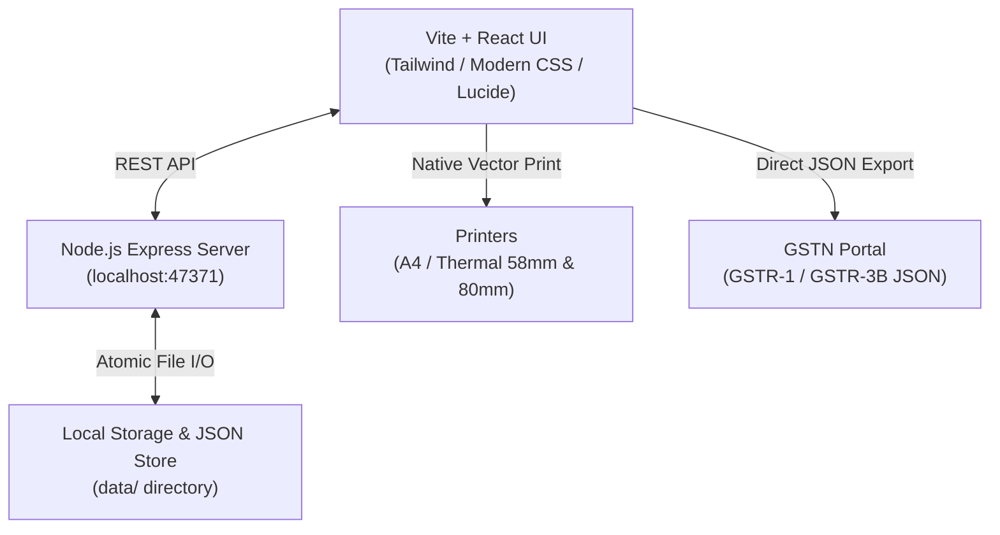

<div align="center">

# QuickGST Billing

### Fast, 100% Offline GST Invoicing &amp; POS Software for Indian Businesses
**Built by Stova Media**

[](LICENSE)
[](#installation--quick-start)
[-16a34a.svg)](#gst-compliance--tax-filing)
[](#privacy--data-security)
[](#why-quickgst-billing)

<p align="center">
  <b>Create GST-compliant invoices, export GSTR-1 &amp; GSTR-3B JSON, generate E-Way Bills, print thermal POS receipts with UPI QR codes, and manage inventory — 100% offline, forever.</b>
</p>

</div>

---

## 🚀 Overview

**QuickGST Billing** is an offline-first desktop invoicing and business management platform designed specifically for Indian retailers, wholesalers, contractors, agencies, and MSMEs. 

Unlike subscription billing apps (Zoho, Vyapar, myBillBook) that lock your company records onto cloud servers and require recurring annual renewals, **QuickGST Billing runs directly on your computer**. Your financial data never leaves your machine, works flawlessly without an active internet connection, and comes with zero monthly fees.

---

## ⚡ Key Highlights

* **🇮🇳 100% Indian GST Compliant**: Automatic CGST, SGST, IGST, and UTGST calculation based on buyer and seller state codes (01 to 38).
* **📄 Portal-Ready Return Exports**: 1-click JSON export for **GSTR-1** and **GSTR-3B** conforming to standard GSTN offline schema (v1.7), plus **GSTR-2B reconciliation**.
* **🚚 E-Way Bill JSON**: Generate NIC-compliant JSON ready for instant upload on the government E-Way Bill portal (`ewaybillgst.gov.in`).
* **🖨️ Multi-Format Printing**:
  * **A4 / A5 Tax Invoices**: Rule 48 compliant multi-copy printing (*Original for Buyer*, *Duplicate for Transporter*, *Triplicate for Supplier*).
  * **Thermal POS Receipts**: High-speed 58mm and 80mm vector receipts for retail counters.
* **📱 Dynamic UPI QR Codes**: Generates custom UPI payment QR codes (PhonePe, Google Pay, Paytm, BHIM) on every bill for immediate payment collection.
* **📦 Inventory & Stock Control**: Real-time stock deduction, reorder thresholds, low-stock warnings, and barcode scanner support.
* **💼 Client Ledger & Cash Book**: Track party outstandings, customer payment histories, client credit balances, daybook cash flows, and expense receipts.
* **🏢 Multi-Business Profiles**: Manage multiple firms and distinct GSTIN numbers side by side with isolated books.
* **🔒 Total Privacy & Security**: Operates strictly on `127.0.0.1`. No background tracking, no third-party analytics, and automatic daily local backups.

---

## 📊 Comparison: QuickGST vs. Subscription Software

| Feature | **QuickGST Billing** | Tally Prime | Vyapar | Zoho Books |
| :--- | :---: | :---: | :---: | :---: |
| **Pricing Model** | **Lifetime / No Subscriptions** | ₹22,500 – ₹67,500 | ₹2,599 – ₹3,999/year | ₹899 – ₹2,999/month |
| **Data Storage** | **100% Local (On your PC)** | Local | Cloud Sync | 100% Cloud |
| **Works Completely Offline** | ✅ Yes | ✅ Yes | ⚠️ Limited | ❌ No |
| **GSTR-1 / 3B JSON Export** | ✅ 1-Click Export | ✅ Paid module | ⚠️ CSV only | ✅ Standard+ tier |
| **E-Way Bill Generation** | ✅ Built-in | ✅ Yes | ❌ Add-on | ✅ Premium |
| **Thermal POS Receipts (58/80mm)**| ✅ Built-in vector | ⚠️ Hard setup | ⚠️ Paid tier | ⚠️ Limited |
| **UPI QR on Invoices** | ✅ Automatic | ⚠️ Complex script| ⚠️ Paid tier | ✅ Standard+ |
| **Ease of Use (Counter staff)** | ⚡ 60-second learning curve | ❌ Requires trained CA | ⚠️ Moderate | ⚠️ Complex |

---

## 🛠️ Architecture & Tech Stack



* **Frontend**: React 19, Vite, Lucide Icons, Modern CSS tokens.
* **Server**: Node.js Express server running bound to `127.0.0.1:47371`.
* **Storage**: Atomic file persistence (JSON files in local data directory) with daily snapshots and 30-day retention.
* **Packaging**: Windows Setup Executable (`.exe`), `.hta` launcher, macOS launcher, and Linux AppImage.

---

## 💻 Developer Guide: Setup & Run

### Prerequisites
* [Node.js](https://nodejs.org/) (v18.0.0 or higher recommended)
* `npm` (bundled with Node.js)

### 1. Clone the Repository
```bash
git clone https://github.com/hasankhan10/quickgst-billing.git
cd quickgst-billing
```

### 2. Install Dependencies
```bash
npm install
```

### 3. Run in Development Mode
```bash
npm run dev
```
* The local backend server boots up on `http://localhost:47371`.
* Vite dev server boots with live hot-module reload.

### 4. Build for Production
```bash
npm run build
```
Generates production-ready, minified bundles into the `dist/` directory.

### 5. Start Production Server
```bash
npm start
```

---

## 🔒 Privacy & Data Security

1. **Zero External Calls for Business Data**: All invoices, customers, inventory numbers, and bank account information are stored purely on your local machine.
2. **Local Loopback Only**: The backend process exclusively binds to localhost (`127.0.0.1`), rejecting unauthorized requests from external networks.
3. **Automated Daily Backups**: Local state snapshots are saved into timestamped archive directories daily, with transactional rollback on restore.

---

## 🤝 Custom Development & Enterprise Support

**QuickGST Billing** is actively maintained and backed by **Stova Media**. 

We offer professional business services for enterprises, retail chains, and distributors:
* **Custom Invoice & Receipt Formats**: Tailored styling, watermarks, and custom terms.
* **Hardware Integration**: On-site or remote setup of thermal receipt printers, cash drawers, and barcode scanners.
* **Data Migration**: Effortless migration from legacy Tally, Busy, or Excel sheets.
* **Annual Maintenance Contracts (AMC)**: Dedicated technical support for retail counters.

* **Email**: support@stovamedia.com  
* **Website**: [stovamedia.com](https://stovamedia.com)

---

## 📄 License

This software is released under the [MIT License](LICENSE). You are free to use, modify, distribute, and integrate it into commercial solutions.
